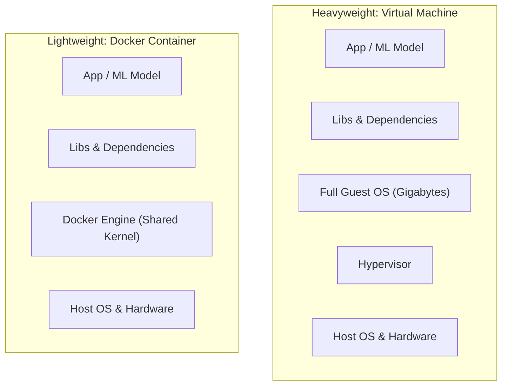

# Lab 02: Production ML Containerization with Docker 🐳

[](https://www.docker.com/)
[](https://www.python.org/)
[](https://fastapi.tiangolo.com/)
[]()
[]()

> **Audience**: AI Engineers, ML Engineers & Infrastructure Beginners  
> **Core Focus**: **Packaging & Containerization** (Packaging ML models and APIs into secure, immutable, production-ready Docker containers).

---

## 📑 Table of Contents
1. [Why Containerization Matters in MLOps](#1-why-containerization-matters-in-mlops)
2. [The Mental Model: Images vs Containers vs Virtual Machines](#2-the-mental-model-images-vs-containers-vs-virtual-machines)
3. [Stage 1: The Minimal Dockerfile (5 Core Directives)](#3-stage-1-the-minimal-dockerfile-5-core-directives)
4. [Stage 2: Production Best Practices in `Dockerfile`](#4-stage-2-production-best-practices-in-dockerfile)
5. [The Critical Docker Concepts Every AI Engineer Must Know](#5-the-critical-docker-concepts-every-ai-engineer-must-know)
6. [Step-by-Step Hands-on Guide (Building & Running)](#6-step-by-step-hands-on-guide-building--running)
7. [Simulating Production Resource Limits (CPU & RAM)](#7-simulating-production-resource-limits-cpu--ram)
8. [MLOps Interview Questions & Key Takeaways](#8-mlops-interview-questions--key-takeaways)

---

## 1. Why Containerization Matters in MLOps

In traditional software development, running code locally is often enough. But in **Machine Learning**, deployment failure is frequent due to the **"It works on my machine"** trap:

```text
Developer's Laptop:         Production Server / Kubernetes:
• Python 3.10.12            • Python 3.11 (breaks dependencies!)
• Scikit-learn 1.3.0        • Scikit-learn 1.4.0 (Joblib deserialization error!)
• C++ compilation tools     • Minimal Linux alpine (Missing BLAS / LAPACK libraries)
• Windows / macOS paths     • Linux paths (/app/model.joblib)
─────────────────────       ─────────────────────────────────────────────────────
   Result: IT WORKS!           Result: CRASH AT 3:00 AM IN PRODUCTION! 💥
```

### The Solution: An Immutable Container
Docker freezes **everything** inside an immutable box:
1. The exact Operating System user space (Debian Linux).
2. The exact Python interpreter version (Python 3.10).
3. The exact library dependencies (`scikit-learn`, `numpy`, `fastapi`).
4. The serialized ML model artifact (`model.joblib`).
5. The application code (`app.py`).

Once packaged, the exact same container runs identically on your laptop, an AWS EC2 instance, or a Google Cloud Kubernetes cluster.

---

## 2. The Mental Model: Images vs Containers vs Virtual Machines



### The 3 Core Docker Primitives:
- **Dockerfile**: The *recipe* (text file describing how to build your environment).
- **Docker Image**: The *frozen cake* (a read-only snapshot containing the OS, libraries, and code).
- **Docker Container**: The *eating of the cake* (a running, live instance of an image).

---

## 3. Stage 1: The Minimal Dockerfile (5 Core Directives)

To understand Docker without feeling overwhelmed, start with [`Dockerfile.minimal`](./Dockerfile.minimal). It uses just 5 directives:

```dockerfile
# 1. Base Image: start with a slim Python runtime
FROM python:3.10-slim

# 2. Working directory inside the container
WORKDIR /app

# 3. Copy dependencies and install them
COPY requirements.txt .
RUN pip install --no-cache-dir -r requirements.txt

# 4. Copy source code & model
COPY . .

# 5. Expose port & specify container entrypoint
EXPOSE 8000
CMD ["uvicorn", "app:app", "--host", "0.0.0.0", "--port", "8000"]
```

---

## 4. Stage 2: Production Best Practices in `Dockerfile`

While the minimal version works, production systems require enterprise security, real-time logging, and health probing. Open [`Dockerfile`](./Dockerfile) to see the production upgrades:

### 1. Real-time Log Flushing (`PYTHONUNBUFFERED=1`)
```dockerfile
ENV PYTHONDONTWRITEBYTECODE=1 \
    PYTHONUNBUFFERED=1
```
> **Why?** By default, Python buffers stdout. In Docker, this means your `print()` and log statements won't appear in `docker logs` until a buffer fills up. Setting `PYTHONUNBUFFERED=1` forces immediate real-time output.

### 2. Security: Never Run as `root`
```dockerfile
RUN useradd --create-home --uid 1000 --shell /bin/bash appuser
COPY --chown=appuser:appuser . .
USER appuser
```
> **Why?** If an attacker exploits a vulnerability in an endpoint and the container runs as `root`, they could gain host privileges. Creating an unprivileged `appuser` limits the blast radius.

### 3. Native Docker Healthcheck
```dockerfile
HEALTHCHECK --interval=30s --timeout=5s --start-period=5s --retries=3 \
    CMD curl -f http://localhost:8000/health || exit 1
```
> **Why?** Allows Docker and container orchestrators (Kubernetes, AWS ECS) to know if the model is alive and ready to accept traffic. If `/health` fails, the container is automatically flagged as `unhealthy`.

---

## 5. The Critical Docker Concepts Every AI Engineer Must Know

### Concept A: The `0.0.0.0` vs `127.0.0.1` Rule
- Inside a container, `127.0.0.1` (localhost) means **only inside this container**. If Uvicorn listens on `127.0.0.1`, outside requests from your laptop cannot reach it!
- `0.0.0.0` tells Uvicorn to listen on **all network interfaces**, allowing traffic forwarded from your host computer to pass through.

### Concept B: Docker Layer Caching
Docker builds images in **cached layers**. If a line has not changed, Docker reuses the previous build cache:

```text
Step 1: COPY requirements.txt .      --> [Cached] (Fast!)
Step 2: RUN pip install ...          --> [Cached] (Skips downloading 200MB!)
Step 3: COPY . .                     --> [Rebuilt only when code changes]
```
> ⚠️ **Rule of Thumb**: Always copy and install `requirements.txt` *before* copying application code (`COPY . .`). Otherwise, changing a single comment in `app.py` forces Docker to re-download all Python packages!

### Concept C: Port Forwarding (`-p 8000:8000`)
```text
Host Machine (Your Laptop)            Docker Container
[ Browser / Client ] ──► Port 8000 ──► [ Port 8000 (FastAPI) ]
                              ▲
                       -p HOST:CONTAINER
```

---

## 6. Step-by-Step Hands-on Guide (Building & Running)

### ⚠️ Mandatory Prerequisite: Docker Desktop Must Be Running!

Before typing any `docker` commands in your terminal, **Docker Desktop must be launched and actively running**.

#### Why is Docker Desktop Needed?
1. **The Client vs Server Architecture**:
   - `docker` in your terminal is just a **client CLI** (a messenger).
   - The actual work (building layers, allocating RAM/CPU, running containers) is performed by a background engine called the **Docker Daemon**.
   - If Docker Desktop is closed, the messenger has nobody to talk to.
2. **Why Windows / macOS Need It (The Linux Kernel)**:
   - Production containers run on **Linux**.
   - Windows and macOS do not natively run Linux container processes. Docker Desktop runs a lightweight Linux subsystem in the background (**WSL 2 on Windows**) to execute Linux containers seamlessly on your laptop.

#### 🚨 Common Student Pitfall:
If you see this error:
```text
ERROR: failed to connect to the docker API at npipe:////./pipe/dockerDesktopLinuxEngine;
open //./pipe/dockerDesktopLinuxEngine: The system cannot find the file specified.
```
**Fix**: Open the Start menu, launch **Docker Desktop**, and wait 30 seconds until the Docker whale icon in your taskbar shows **"Engine running"** (green light).

Verify it is running:
```bash
docker version
```
*(Both "Client" and "Server" must appear without errors!)*

---

### Step 1: Build the Docker Image
Navigate to `02-containerization-docker` and run:

```bash
docker build -t ml-app .
```

> 💡 **Notice**: Watch the terminal output. Notice how Docker executes each step sequentially, creating intermediate image layers.

---

### Step 2: Run the Container
Start the container with port mapping:

```bash
docker run -p 8000:8000 --name ml-api ml-app
```

Explanation of flags:
- `-d`: Run in **detached mode** (in the background, freeing your terminal).
- `-p 8000:8000`: Map host port 8000 to container port 8000.
- `--name ml-api`: Assign a friendly name to the container instead of a random hash.
- `ml-serving:v1`: The image name and tag to run.

---

### Step 4: Verify the Container Status & Logs
Check that the container is running and healthy:
```bash
# List running containers
docker ps

# Follow container logs in real time
docker logs -f ml-api
```
*(Press `Ctrl+C` to exit log stream).*

---

### Step 5: Test the Running Container
In another terminal, run the automated verification script:
```bash
python test_container.py
```

Or test using `curl` / browser:
```bash
# 1. Healthcheck
curl http://localhost:8000/health

# 2. Prediction request
curl -X POST http://localhost:8000/predict \
     -H "Content-Type: application/json" \
     -d "{\"features\": [1.2, -0.5, 3.1, 0.0, 2.7]}"
```

Open interactive Swagger documentation in your browser:
👉 **[http://localhost:8000/docs](http://localhost:8000/docs)**

---

### Step 6: Explore Inside the Container (Debugging)
To see how the Linux environment looks inside the container:
```bash
docker exec -it ml-api bash
```
Inside the container, run:
```bash
whoami         # Output: appuser (non-root security in action!)
pwd            # Output: /app
ls -la         # Notice clean files, no virtualenv or junk
exit           # Exit container back to host
```

---

### Step 7: Stop and Remove the Container
When done testing:
```bash
# Stop the running container
docker stop ml-api

# Remove the container
docker rm ml-api
```

---

## 7. Simulating Production Resource Limits (CPU & RAM)

In cloud environments (like Kubernetes or AWS ECS), you must prevent ML models from consuming all node memory and crashing neighboring services.

Docker lets you test resource caps locally:

```bash
docker run -d -p 8000:8000 \
    --name ml-api-constrained \
    --cpus="1.0" \
    --memory="512m" \
    ml-serving:v1
```

- `--cpus="1.0"`: Restricts the container to at most 1 CPU core.
- `--memory="512m"`: Caps container RAM at 512 Megabytes. If your model leaks memory beyond 512MB, Docker will trigger an Out-Of-Memory (`OOMKilled`) termination.

Check live resource consumption:
```bash
docker stats ml-api-constrained
```

---

## 8. MLOps Interview Questions & Key Takeaways

| Question | Production Answer |
| :--- | :--- |
| **Why should you avoid `python:latest` or `ubuntu:latest`?** | Tag `:latest` is mutable; dependencies can break silently when upstream pushes changes. Always pin explicit tags like `python:3.10-slim`. |
| **Why should you never run Docker containers as `root`?** | Running as root creates severe security risks; container breakout vulnerabilities could compromise the host operating system. |
| **Why use `.dockerignore`?** | Prevents giant local directories (like `venv/` or `.git/`) from bloating the Docker build context and leaking secrets. |
| **What happens if Uvicorn listens on `127.0.0.1` inside Docker?** | The service is unreachable from outside the container. Containers require `0.0.0.0` to accept forwarded host traffic. |
